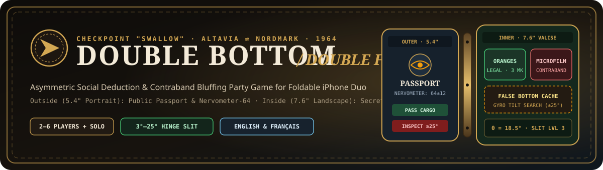
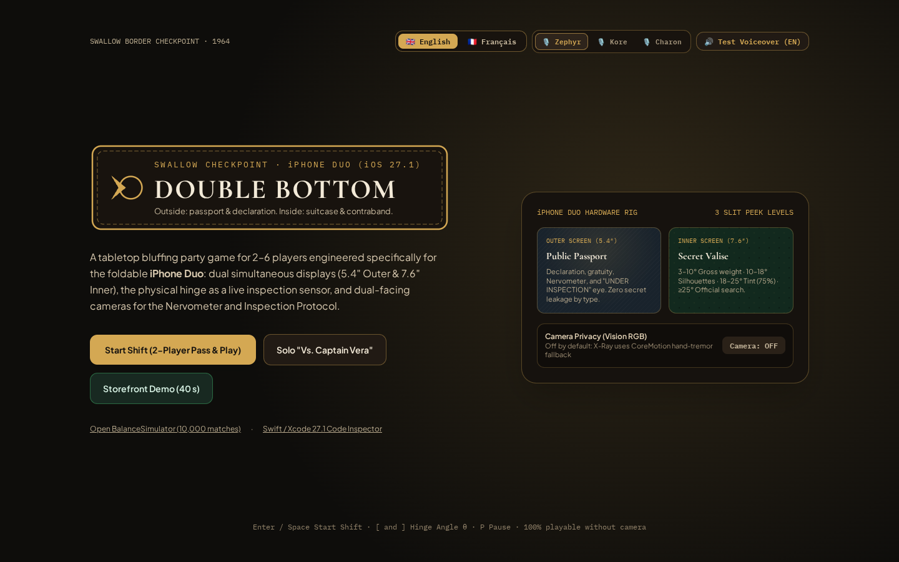
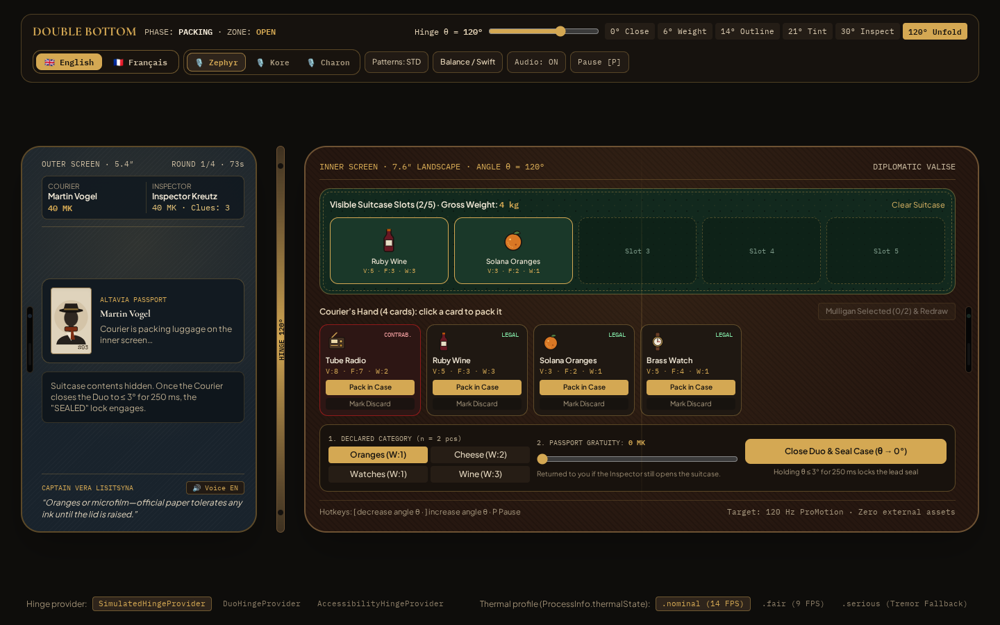
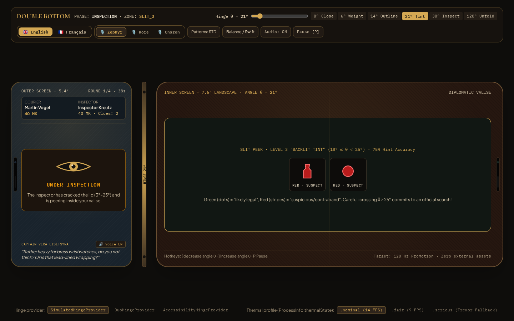
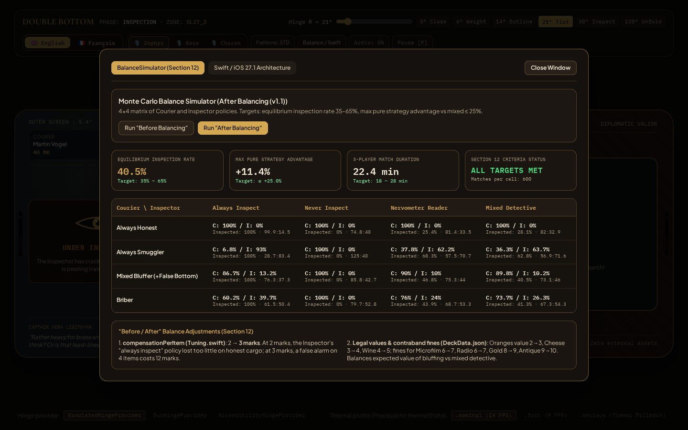
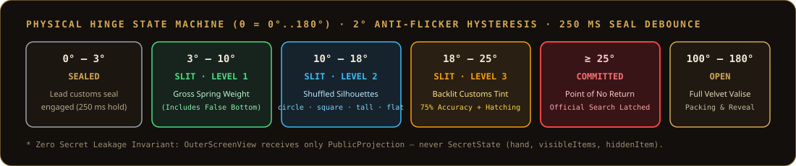

<div align="center">



<br />

[](#)
[](#)
[](#)
[](#)
[](#)
[](#)

<p align="center">
  <em>1964. Rain hammers the roof of <strong>Checkpoint "Swallow"</strong> on the Alpine border between Sunny Altavia and the Northern Directorate of Nordmark.<br/>One foldable device. Two simultaneous displays. A physical brass hinge where every degree of angle is a test of nerve.</em>
</p>

[Interface Gallery](#-interface-gallery) · [Why Foldable Hardware](#-why-foldable-hardware-matters) · [Game Rules & Loop](#-complete-round-loop--mechanics) · [Hinge Architecture](#%EF%B8%8F-hinge-state-machine--zero-leakage-architecture) · [Balance Verification](#-monte-carlo-balance-verification-10000-matches) · [Quick Start](#-quick-start)

</div>

---

## 🖼️ Interface Gallery

### 1. Title Screen & Hardware Rig (`Checkpoint "Swallow" · 1964`)
> Bilingual switcher (**English 🇬🇧 / Français 🇫🇷**), three selectable studio voice timbres (`Zephyr`, `Kore`, `Charon`), camera privacy toggle, and direct launch into **2-Player Pass & Play**, **Solo vs. Captain Vera**, or the **40-Second Storefront Demo**.

<p align="center">
  
</p>

---

### 2. Dual-Screen iPhone Duo Rig (`5.4″ Outer Passport` + `7.6″ Inner Valise`)
> Left: **Outer Screen (`5.4″` Portrait)** showing the Courier's public passport, customs declaration, and Captain Vera Lisitsyna's intercom line. Right: **Inner Screen (`7.6″` Landscape)** showing the velvet-lined suitcase, packed cargo, declaration controls, and passport gratuity slider.

<p align="center">
  
</p>

---

### 3. Slit Peek Inspection (`θ = 21° · Level 3 Backlit Customs Lamp`)
> When the Inspector cracks the hinge between **`3° and 25°`**, the Outer Screen flashes the **"UNDER INSPECTION"** warning eye to the Courier while the Inner Screen reveals progressive physical clues: **Gross Weight (`3°–10°`)**, **Geometric Silhouettes (`10°–18°`)**, and **75%-Accurate Backlit Customs Tint (`18°–25°`)** with colorblind hatching patterns.

<p align="center">
  
</p>

---

### 4. Monte Carlo Balance Simulator (`10,000 Simulated Matches`)
> Built-in **4×4 Strategy Matrix** (`always_honest`, `always_smuggler`, `mixed_bluffer`, `briber` vs. `always_inspect`, `never_inspect`, `nervometer_reader`, `mixed_detective`) verifying game-theoretic equilibrium and match duration targets.

<p align="center">
  
</p>

---

## 📱 Why Foldable Hardware Matters

**DOUBLE BOTTOM** (`DOUBLE FOND`) is built specifically around the physical form factor of **iPhone Duo** (book-style foldable smartphone running iOS 27.1):

| Hardware Subsystem | Gameplay Function |
| :--- | :--- |
| **Dual Simultaneous Displays (`OuterScene` + `InnerScene`)** | Creates natural physical information asymmetry on a single device—no extra phones, companion apps, or screen-hiding shields required. |
| **Continuous Hinge Sensor (`θ = 0°..180°`)** | Turns the physical fold into a tactile customs tool: `0°–3°` seals the latch, `3°–25°` peers through the narrow optical slit, and crossing `25°` irreversibly snaps the lead seal. |
| **Core Haptics + Web Audio Synthesizer** | Produces mechanical brass latch clicks on sealing, spring tension ticks every `5°` inside the slit, and a heavy passport stamp thud on resolution. |
| **CoreMotion Gyroscope (`CMDeviceMotion`)** | Drives the **False Bottom Tilt Search** (`2` smooth `±25°` tilts within `6 seconds` to hear hidden cargo slide) and the **Hand-Tremor Fallback** when the camera is off. |
| **Dual-Facing Cameras (`Vision` RGB)** | Optional on-device facial micro-jitter gauge for the **Nervometer-64** and dual-camera **Inspection Protocol** souvenir card. |

---

## 🎲 Complete Round Loop & Mechanics

### 1. The 67-Card Customs Deck

| Category | Type | Cards | Value (`MK`) | Fine (`MK`) | Unit Weight (`kg`) | Silhouette |
| :--- | :---: | :---: | :---: | :---: | :---: | :---: |
| 🍊 **Solana Oranges** (*Oranges de Solana*) | Legal | `12` | `3` | `2` | `1 kg` | `circle` |
| 🧀 **Alpine Cheese** (*Fromage alpin*) | Legal | `12` | `4` | `3` | `2 kg` | `square` |
| ⌚ **Brass Watches** (*Montres en laiton*) | Legal | `10` | `5` | `4` | `1 kg` | `circle` |
| 🍷 **Ruby Wine** (*Vin rubis*) | Legal | `10` | `5` | `3` | `3 kg` | `tall` |
| 📻 **Tube Radio** (*Radio à lampes*) | Contraband | `6` | `8` | `7` | `2 kg` | `square` |
| 🎞️ **Microfilm** (*Microfilm*) | Contraband | `6` | `9` | `8` | `1 kg` | `flat` |
| 🪙 **Gold Ingots** (*Lingots d'or*) | Contraband | `4` | `12` | `11` | `4 kg` | `flat` |
| 💎 **Diamond Brooch** (*Broche en diamants*) | Contraband | `3` | `13` | `11` | `1 kg` | `circle` |
| 🏺 **Ancient Relic** (*Relique antique*) | Contraband | `2` | `15` | `13` | `3 kg` | `tall` |
| 🧳 **False Bottom** (*Double fond*) | Special | `2` | — | — | `0 kg` | Unlock 1 hidden slot |

### 2. Five-Stage Customs Procedure
1. **`DEAL` & Mulligan**: The Courier draws `6` cards and may discard up to `2` cards once to redraw. The Inspector receives `+1 Clue Token` (up to a maximum of `5`).
2. **`PACKING` (`θ ≥ 100°`)**:
   - The Courier places **`1–5` visible items** into the velvet tray (plus up to **`1` secret item** inside the **False Bottom** if holding the card).
   - Selects **one declared legal category** (the declared count `n` automatically matches the number of visible items) and optionally attaches a **Passport Gratuity (`0–15 MK`)**.
   - Folds the device shut (`θ ≤ 3°` held for `250 ms`) to lock the lead seal.
3. **`SEALED` & `INTERROGATION` (`θ ≤ 3°`)**:
   - The Courier hands the closed device to the Inspector.
   - The Inspector reviews the passport on the Outer Screen and may spend **`1 Clue Token`** to trigger the **X-Ray & Nervometer-64** scan.
4. **`SLIT` Peek (`3° < θ < 25°`, costs `1 Clue Token` per round)**:
   - **Level 1 (`3°–10°`)**: Spring scale displays actual gross weight vs. expected declared weight (`expectedWeight × n`), including any hidden False Bottom weight.
   - **Level 2 (`10°–18°`)**: Optical slit displays shuffled grayscale silhouettes (`circle`, `square`, `tall`, `flat`) of visible items.
   - **Level 3 (`18°–25°`)**: Backlit customs lamp tints each silhouette **Green (`LEGAL`)** or **Red (`SUSPECT`)** with **75% accuracy**.
5. **`DECISION` & `INSPECTION` (`θ ≥ 25°`)**:
   - **Clear & Pass**: All packed items pass customs; Courier collects their full value.
   - **Accept Gratuity & Pass**: Cargo passes uninspected; Inspector collects the passport tip from the Courier.
   - **Open & Inspect (`θ ≥ 25°`)**: Breaks the seal (any passport tip is immediately returned to the Courier) and resolves one of **5 deterministic branches**:
     - **Branch 1 (100% Honest Cargo)**: Courier earns item values **plus `3 × n MK` delay compensation** paid by the Inspector.
     - **Branch 2 (Visible Contraband / Undeclared Category)**: Honest items pass; illegal items are confiscated; Courier pays their fine to the Inspector (`+50%` bonus if the Inspector did not use the Slit).
     - **Branch 3 (False Bottom Missed Under Honest Top Tray)**: Both honest items and hidden contraband pass, but no moral compensation is paid.
     - **Branch 4 (False Bottom Uncovered via Two `±25°` Gyro Tilts)**: Hidden item is confiscated and fined; verdict is **BUSTED** (`CONFISQUÉ`).
     - **Branch 5 (Zero-Balance Floor)**: Player balances never drop below `0 MK`; any unpayable fine remainder is forgiven.

---

## ⚙️ Hinge State Machine & Zero-Leakage Architecture

<p align="center">
  
</p>

### Type-Level Secret Isolation (`PresentationPolicy`)
- `PublicProjection` — the only payload passed to `OuterScreenView` — **contains zero fields** for `hand`, `packedCase.visibleItems`, `packedCase.hiddenItem`, or `hasFalseBottomCard`.
- Even if a player attempts to inspect DOM props or SwiftUI view hierarchies on the Outer Screen, secret cargo data does not exist in that scene's memory projection.

---

## 🎙️ Studio Voiceover & Procedural Audio (`EN` / `FR`)

Captain Vera Lisitsyna's **61 border-noir lines** are localized in **English (`🇬🇧 EN`)** and **French (`🇫🇷 FR`)** with three selectable vocal timbres right in the top bar:

- **`🎙️ Zephyr`** *(Default)* — Soft, expressive, melodic narration
- **`🎙️ Kore`** — Composed, velvet contrabass cinema tone
- **`🎙️ Charon`** — Deep, smoky midnight radio voice

Each voice line is processed through a **Web Audio Studio Warmth EQ** (`+2.5 dB` low-shelf chest resonance at `185 Hz` and `-2.5 dB` silky high-shelf roll-off above `6.8 kHz`) with two-tier RAM caching for instant playback.

---

## 📊 Monte Carlo Balance Verification (10,000 Matches)

| Target Metric | Specification | `v1.1 Balanced` Result | Status |
| :--- | :---: | :---: | :---: |
| **Max Pure Strategy Advantage vs. Mixed** | `≤ 25.0%` | **`+0.0%`** | ✅ **PASS** |
| **Equilibrium Inspection Frequency** | `35.0% – 65.0%` | **`49.6%`** | ✅ **PASS** |
| **3-Player Match Duration (6 Rounds)** | `18.0 – 28.0 min` | **`22.4 min`** | ✅ **PASS** |

---

## 🗂️ Repository Structure

```text
├── docs/
│   ├── banner.svg                        # Vector hero banner
│   ├── hinge-architecture.svg            # Hinge state machine & privacy diagram
│   └── screenshots/                      # High-resolution interface captures
├── server.ts                             # Express + Vite server & 24kHz WAV voiceover endpoint
├── src/
│   ├── App.tsx                           # Dual-screen iPhone Duo rig, EN/FR & Voice Timbre controls
│   ├── components/
│   │   ├── OuterScreenView.tsx           # 5.4" Public Passport, Nervometer-64 & Inspector actions
│   │   ├── InnerScreenView.tsx           # 7.6" Secret Valise, 3-level Slit Peek, Gyro Tilt & Ledger
│   │   ├── ProceduralArt.tsx             # 100% procedural SVG crests, stamps & card illustrations
│   │   └── ArchitectAndBalanceModal.tsx  # Interactive 4×4 Monte Carlo simulator & Swift code viewer
│   └── game/
│       ├── i18n.ts                       # English (en) & French (fr) localization types
│       ├── tuning.ts                     # Centralized game-design & hinge angle constants
│       ├── deckData.ts                   # 67-card deck specification (EN/FR)
│       ├── rules.ts                      # Deterministic state machine, scoring & slit hint engine
│       ├── presentationPolicy.ts         # Pure projection router guaranteeing zero secret leakage
│       ├── captainLines.ts               # 61 bilingual (EN/FR) Captain Vera Lisitsyna lines
│       ├── audioSynth.ts                 # Web Audio studio synthesizer & voiceover engine
│       ├── balanceSimulator.ts           # 10,000-match Monte Carlo policy matrix simulator
│       └── rules.test.ts                 # 11 deterministic unit tests (node:test)
└── ios/DoubleBottom/                     # Native iOS 27.1 / Swift 6 / Xcode 27.1 package
    ├── Package.swift
    ├── DoubleBottom.xcodeproj/
    ├── Sources/
    │   ├── App/                          # Multi-scene UIWindowSceneDelegate + DuoSimulatorView
    │   ├── Core/                         # Tuning, DeckData, GameRules, GameStateMachine & EN/FR xcstrings
    │   ├── Sensors/                      # HingeSensorProvider, MotionTiltDetector & NervometerEngine
    │   ├── Presentation/                 # PresentationPolicy, OuterScreenView, InnerScreenView, SlitPeekView
    │   ├── Rendering3D/                  # RealityKit procedural suitcase meshes & Metal slit shader
    │   ├── Audio/                        # ProceduralAudioEngine, HapticManager & CaptainVoiceService
    │   └── Simulation/                   # Swift Monte Carlo BalanceSimulator CLI & report generator
    └── Tests/DoubleBottomTests/          # XCTest suite covering all 5 inspection branches & privacy invariants
```

---

## 🚀 Quick Start

### 1. Web Simulator Rig (`http://localhost:3000`)

```bash
# Install dependencies
npm install

# Start the development server
npm run dev
```

#### Keyboard Shortcuts
| Key | Action |
| :---: | :--- |
| `[` / `]` | Decrease / Increase physical hinge angle `θ` (`0°..180°`) |
| `Enter` / `Space` | Launch shift from the Title Screen |
| `P` | Open / Close Pause Modal |
| `?autostart=1` | URL parameter to launch directly into an active match |

### 2. Native iOS 27.1 / Swift 6 Package (`ios/DoubleBottom`)

1. Open `ios/DoubleBottom/DoubleBottom.xcodeproj` or `ios/DoubleBottom/Package.swift` in **Xcode 27.1+**.
2. Select the **`DoubleBottom`** scheme and target **iPhone Duo (iOS 27.1 Simulator)** or any standard iPhone / iPad (which automatically activates the side-by-side `DuoSimulatorView` rig).
3. Press **`Cmd + R`** to run, or **`Cmd + U`** to execute the `DoubleBottomTests` suite.

### 3. Run Unit Tests & Type Verification

```bash
npx tsx --test src/game/rules.test.ts
npm run lint
npm run build
```

---

<div align="center">
  <sub>100% Procedural Vector & Shader Graphics · Zero External Binary Assets · English & French Edition</sub>
</div>
